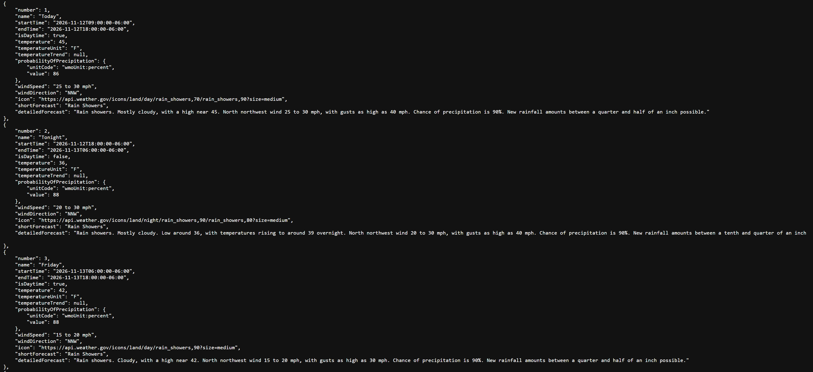
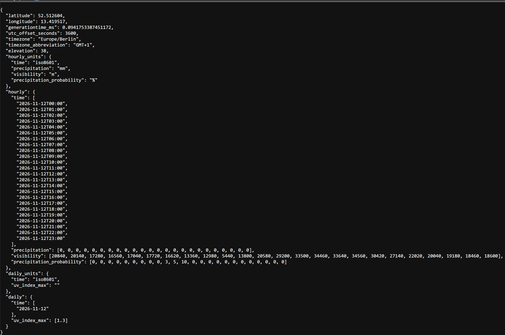

# Evidence | The exact field name, unit and a real example value you retrieved, not something you assumed
https://api.weather.gov/gridpoints/LOT/76,73/forecast

https://api.open-meteo.com/v1/forecast?latitude=52.52&longitude=13.41&daily=uv_index_max&hourly=precipitation,visibility,precipitation_probability&timezone=auto

# Horizon | Does it cover the whole 7 day window? How far ahead does it really go?
National Weather Service covers 7 days
Open-Meteo covers 16 day forecast aggregated from multiple sources. 

# Resolution | Hourly, every few hours, or daily?
National Weather Service seems to up every few hours
Open-Meteo updates every 1-3 hours 

# Gap handling | What does the report show when the field is missing
The APIs return null if a field is missing. The user will be informed about any null values.

# Weather Information and Source
Weather information	| API source |
| :--- | :--- | 
| Temperature	| National Weather Service 
| Wind speed | National Weather Service
| Visibility | Open-Meteo
| UV | Open-Meteo
| Humidity | Open-Meteo
| Rain | National Weather Service
| Snow | National Weather Service