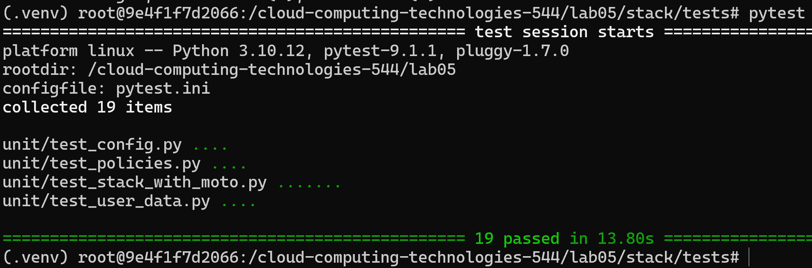
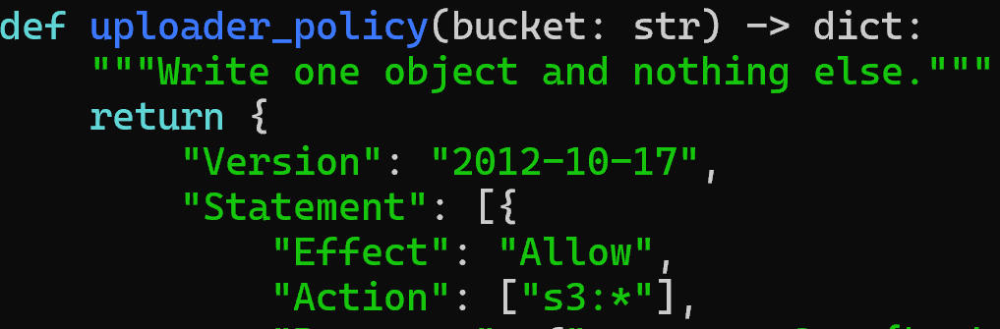
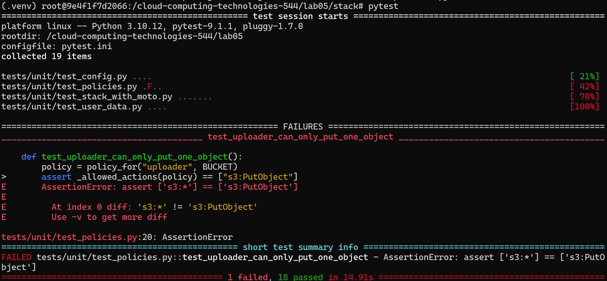

# One paragraph on what moto proved, what it could not, and which tests cover the gap.

# One paragraph comparing ignore_errors("EntityAlreadyExists") with 2>/dev/null || true .

# Pick one place where the bash version was shorter than the Python version. Write two sentences on what the extra Python lines bought you.

# Your answer to Challenge 5.

Output of ls -a lab05 (or a screenshot)

Screenshot of pytest showing 19 passed.

Screenshot of one "break it on purpose" experiment: the changed line and the failing test message.
Changed Line

Failed Test

Screenshot of python create_stack.py completing, with both URLs.

Screenshot of pytest -m integration -v with all 14 tests passing.
Output of pytest -m chaos -s for both tiers, and the same run failing after you tightened the SLO.
Screenshot of python delete_stack.py completing, and a second run completing with no errors.