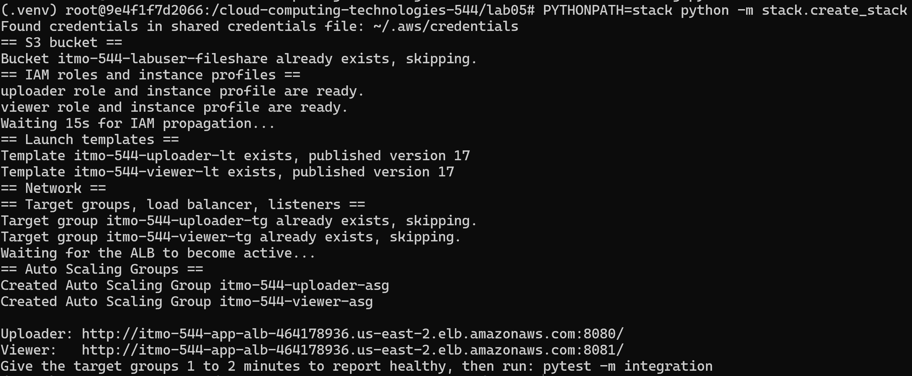
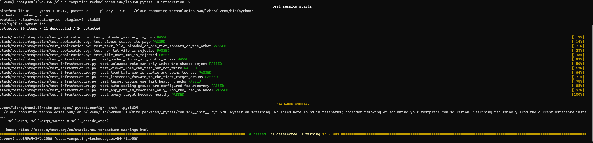
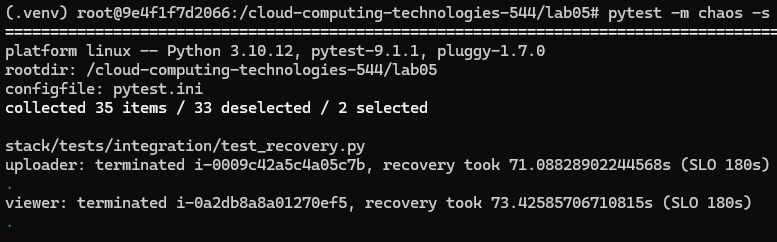
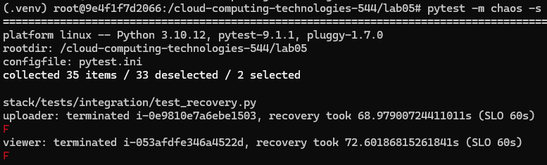
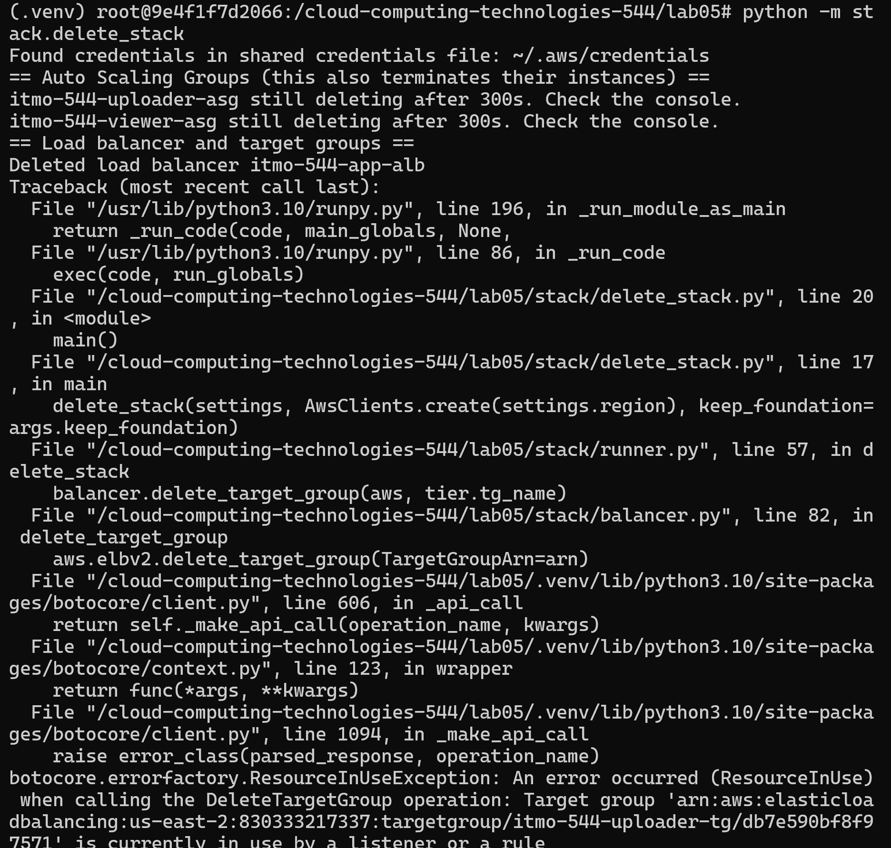
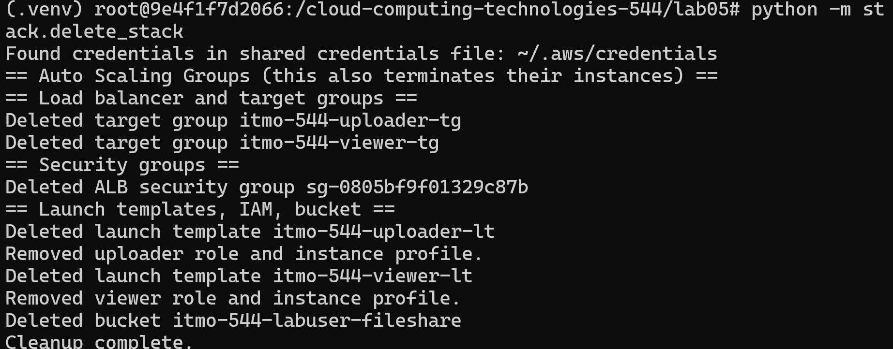

# One paragraph on what moto proved, what it could not, and which tests cover the gap.
Testing with moto proved that the code builds valid AWS calls, formats API parameters correctly, and sequences resource creation logic properly without runtime or type errors. But since, moto could not simulate real cloud behavior, such as actual EC2 instance booting, user-data shell script execution (installing Node.js and launching systemd services), real HTTP load balancer traffic routing, or actual Auto Scaling failure recovery timelines we needed live tests. The live integration suite (test_infrastructure.py and test_application.py) and the chaos test (test_recovery.py) covers this gap by executing end-to-end HTTP probes and measuring actual recovery speeds against real deployed AWS infrastructure.
# One paragraph comparing ignore_errors("EntityAlreadyExists") with 2>/dev/null || true .
2>/dev/null || true in Bash silences errors and forces a successful exit code regardless of why a command failed. But the python ignore_errors("EntityAlreadyExists") helps understand the actual AWS code error. It ignores only expected errors when resources already exist while allowing unexpected failures—such as bad parameters, or permission denials—to display immediately..
# Pick one place where the bash version was shorter than the Python version. Write two sentences on what the extra Python lines bought you.
Loading configuration settings required a single source .env line in Bash compared to roughly 30 lines of code in Python's config.py. The extra Python lines helped create errors if there were missing variables before ever touching AWS.

Output of ls -a lab05 (or a screenshot)

Screenshot of pytest showing 19 passed.

Screenshot of one "break it on purpose" experiment: the changed line and the failing test message.
Changed Line

Failed Test

Screenshot of python create_stack.py completing, with both URLs.

Screenshot of pytest -m integration -v with all 14 tests passing.

Output of pytest -m chaos -s for both tiers, and the same run failing after you tightened the SLO.

Screenshot of python delete_stack.py completing, and a second run completing with no errors.
Errored Delete Stack

No Errors

Because of the way my files are referenced I have to use PYTHONPATH='python -m stack.create_stack' from lab05 folder to create my stack
and 'python -m stack.delete_stack' from lab05 folder to delete the stack