Output of ls -R lab06 | head -40, showing the layout from Part 0. 
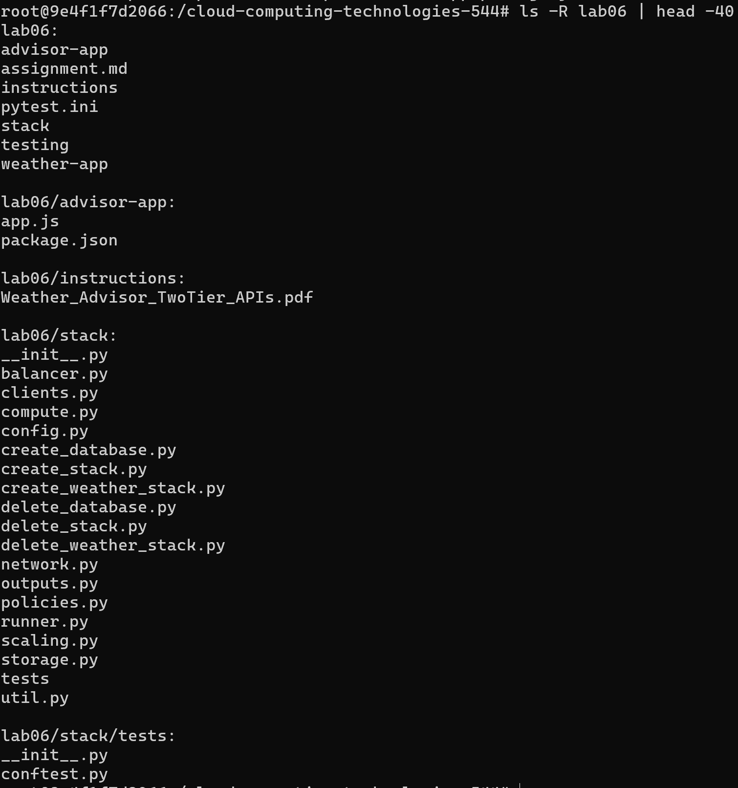

Output of the NWS calls from Part A and one sentence on why two upstream calls are needed. 
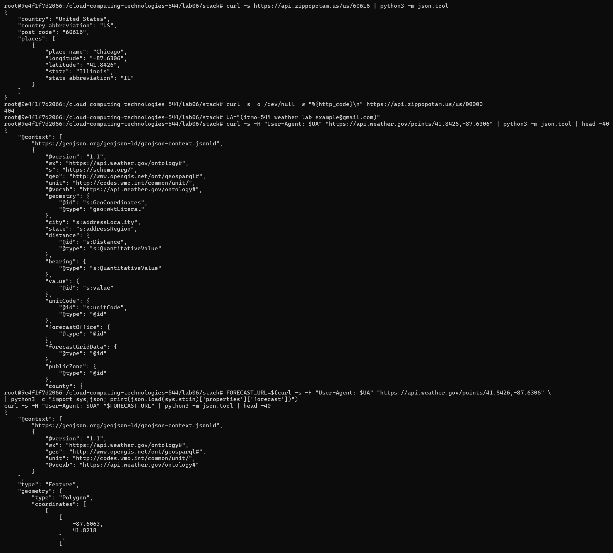
Two upstream calls are needed because the National Weather Service API requires coordinates with longitude and latitude which can be obtained from another API using just the ZIP code of the area.

Output of create_database.py
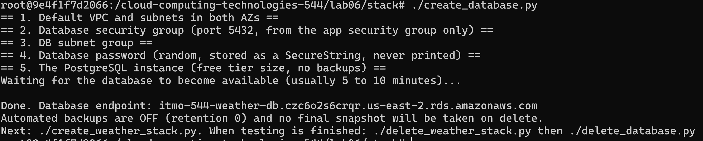
Step 4 output showing retention 0, not public, single-AZ, and empty snapshot and automated backup lists. (Step 4. Prove the database has no backups and no public address)
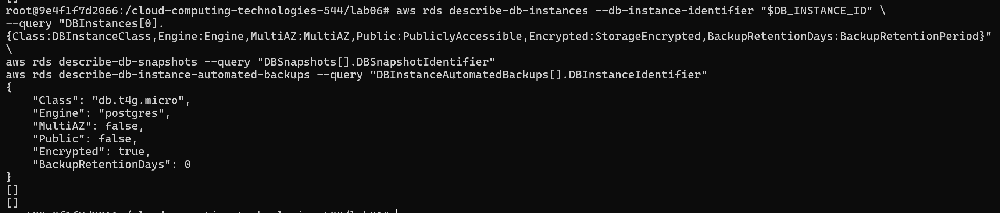

Screenshot of the advisor page showing a suggestion for a zip code, and the JSON from /advice?zip=... for the same zip. 
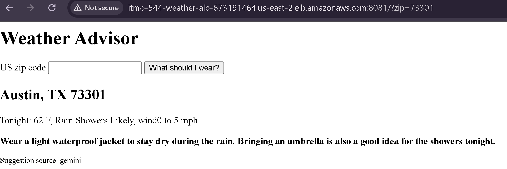
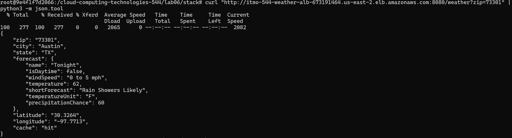

Output of app_smoke_test.py with all nine checks passing.
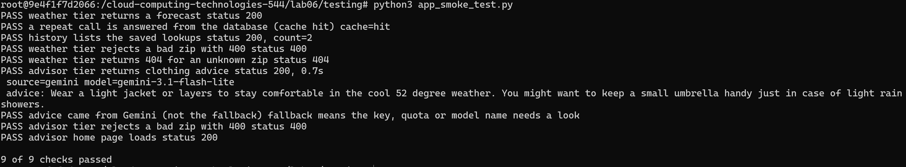

Step 1: a few lines of the weather journal, with a sentence explaining one weather_success line.
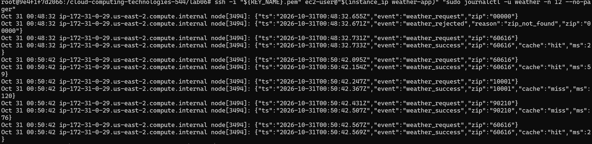
The bottom most line 
 Oct 31 00:50:42 ip-172-31-0-29.us-east-2.compute.internal node[3494]: {"ts":"2026-10-31T00:50:42.569Z","event":"weather_success","zip":"60616","cache":"hit","ms":2
 means that on October 31st there was a successful request to get advice for the zipcode 60616. Cache: hit means that this information was previously obtained and has been cached for future usage making the response time (ms) very quick.

Step 2: the /history output and the psql query output.
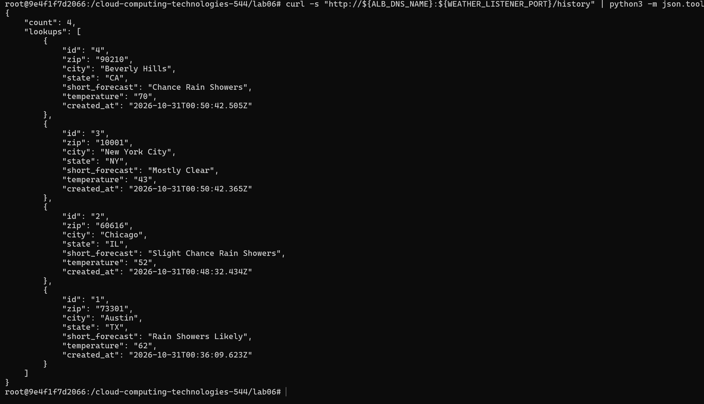
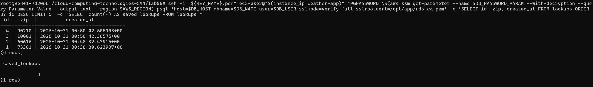

Step 3: the miss and hit timings, and your two sentences.
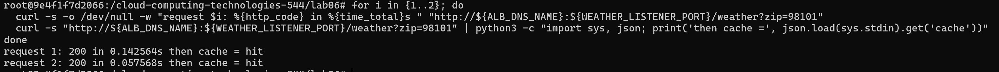
The first attempt to access zip 98101 took 0.1425 seconds because it was reaching out for the first time. On the second request this information had been cached so it reached the result in 0.0575 seconds showing that information is being cached correctly. 

Step 5: the IAM simulator results for both roles and both secrets, and your sentence about the advisor tier.
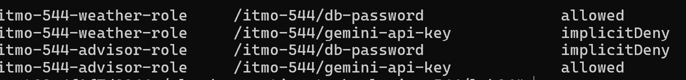
If an attacker took over the advisor role then they would get access to the Gemini API Key, while not good this is less damaging than having the database password. 

Step 6: the direct and through-the-ALB results, and your sentence about security group sources.
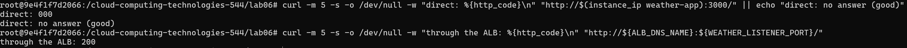
Using the security group allows better scaling without requiring manual IP rule updates.

Step 7: the output while the database was cut off, the db_error log line, and your sentence about the 30 second pause.
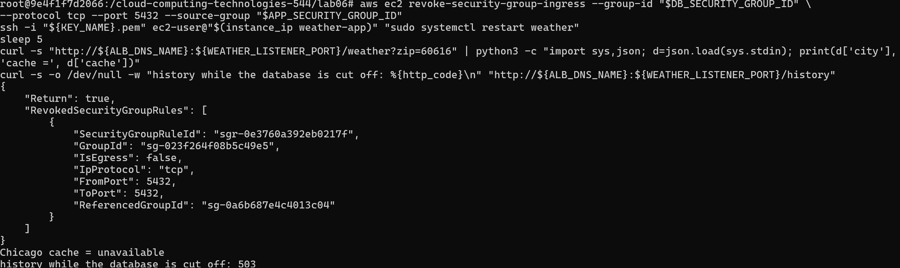
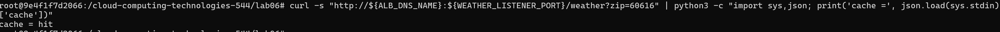
If the pause did not exist requests would continue waiting for the database to respond taking all the resources of the websites. 

Step 8: the fallback answers, the gemini_error journal lines, and your sentence about the weakness of silent fallback.
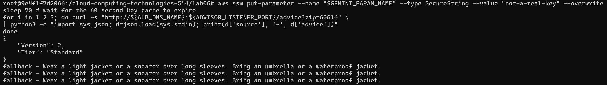
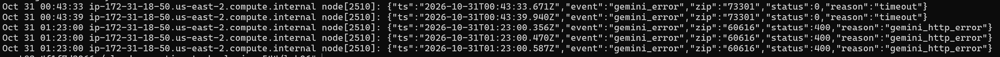
Users believe that their actions worked but actually failed leading to issues later on.

Step 9: the recovery time you measured, what the advisor returned during the outage, and your sentence about where state should live. 
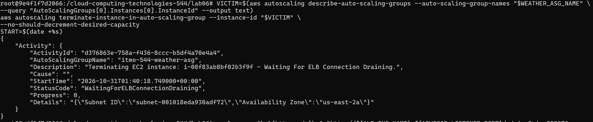
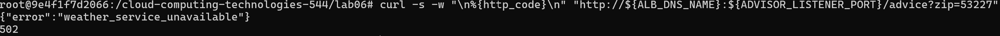
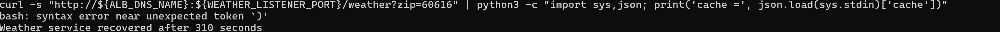
State should live outside of a specific instance unless something should only be temporarily. Managed databases, distributed caches, or object storage should be used if state is meant to be kept and prevent data loss.

Output of the Step 10 verification commands showing no database instance, snapshot, automated backup, load balancer or lab role remains.

### One paragraph on why the secrets are in SSM and each is read by one role, instead of in .env or the user-data. 
Storing secrets in SSM with role enforcement follows the principle of leats privilege. It also helps eliminate some of the risk of .env being uploaded to version control. Shell histories may also expose credentilas stored in .env or user-data scripts. With SSM the values are encrypted and get queried at runtime further protecting these secrets. 

### One paragraph on turning backups off: what it saved, what it cost you, and when you would never do it. 
Turning backups off saved us money by not allowing the instance to restart after 7 days. The problem is without backups data is more likely, almost guranteed, to be lost unless it is being exported before deleting the instances. In a realistic commercial environment where this is a web applicaiton users are interacting with they would be upset to lose their data. For this reason it would be best to maintain backups in almsot any real world scenario. 

### One paragraph on what data you sent to Gemini and why the free tier makes that matter.
Very little data is actually sent to Gemini, in this case it was non-sensitive data from a user-provided ZIP code and a public weather forecast text. Using Gemini's Free Tier does carry privacy risks as Google is now allowed to use the input prompts and model outputs to trian future models. If a user were to accidentally include personally identifiable information it would compromise the user's privacy. The free tier also has a rate limit and daily request caps which makes it hard to scale. A realistic application would need to pay for Gemini subscription that would increase privacy by not allowing data training from inputs and outputs as well as raising the rate limit. 

### Answers to the Section 15.1 review questions. 
[Section 15.1 Review Questions](review_questions.md)

# Graduate Students Only (ITMO 544): Python Checklist
Submit this in addition to everything in 16.1. Every resource you create or delete in this lab must come from your Python code, not from the bash scripts or hand-typed aws commands.
## Code
- [x] create_database.py and delete_database.py (built on your lab05 stack/ package) create and remove the database security group and rule, the DB subnet group, the random password parameter, and the PostgreSQL instance, and write and remove the database outputs.
- [x] The database is created with: class db.t4g.micro, 20 GB, encrypted, single-AZ, not publicly accessible, and BackupRetentionPeriod=0. It is deleted with SkipFinalSnapshot=True and DeleteAutomatedBackups=True.
- [x] create_weather_stack.py and delete_weather_stack.py create and remove everything the bash stack scripts do: roles and profiles, the two least-privilege policies (one secret each), security groups, target groups, the ALB and both listeners, both launch templates and both Auto Scaling Groups.
- [x] The ALB is created before the launch templates, the advisor's user-data receives the ALB DNS name, and the weather user-data receives the database address.
- [x] All create scripts are idempotent (running one twice changes nothing and does not fail) and all delete scripts tolerate resources that are already gone. 
Nothing is hard-coded: names, ports, instance class and cache time come from .env through your config module. 
- [x] No secret appears in any file, log line, test output, user-data or screenshot. The password is made with secrets.token_hex, goes only to SSM and the create call, and the Gemini key is read with getpass. 
- [x] Code is split into small functions with docstrings, and each AWS call that can fail on a missing or existing resource handles the specificClientError code. 

##### NEED TO DO EVERYTHING BELOW THIS

AND THE REVIEW QUESTIONS MD FILE

- [] A Python version of the smoke test (including the cache and history checks) that you can run from pytest.

## Tests (run with pytest)
Unit tests with moto (no real AWS calls): the created database has class db.t4g.micro, BackupRetentionPeriod of 0, MultiAZ false, PubliclyAccessible false and encrypted storage. 
Unit test: the database security group allows port 5432 from the app security group ID and from no CIDR range. 
Unit test: after create then delete, describe_db_instances, describe_db_snapshots and the password parameter are all empty. 
Unit test: the weather role's policy allows ssm:GetParameter on exactly the database password ARN, the advisor role's on exactly the Gemini key ARN, and neither role's policy mentions the other's. 
Unit test: the ALB-first ordering holds (the advisor user-data contains the ALB DNS name), and the weather user-data contains the database host but never the password. Unit test: the generated user-data for each tier is under 16 KB.
Unit test: running each create function twice creates no duplicates.
Integration tests (marked integration, run against your real stack): both target groups are healthy; /weather?zip=60616 called twice returns miss then hit; /history lists the lookup; a bad zip returns 400 and an unknown zip returns 404; /advice returns advice; the app instances are reachable only through the ALB; the database port is not reachable from your computer.
Integration test: iam.simulate_principal_policy reports each role allowed for its own secret and not for the other's. 
Chaos tests (marked chaos): (1) revoke the database rule and restart the weather service, assert the forecast still returns 200 with cache of unavailable, then restore the rule. (2) Terminate the weather instance, assert the advisor returns 502 (not a hang) during the outage, and assert the weather service answers 200 again within 300 seconds.
pytest -m "not integration and not chaos" passes with no AWS credentials, and the summary shows every test.

## Short answers
### Half a page: what moto could not prove for you in this lab (think: real backups, real network reachability, TLS), and which integration test covers each gap. 

### One paragraph comparing the Python and bash versions of the same step (for example creating the database and waiting for it): what was easier to get right, and what was easier to test.