Output of terraform version and aws sts get-caller-identity (hide the account number).
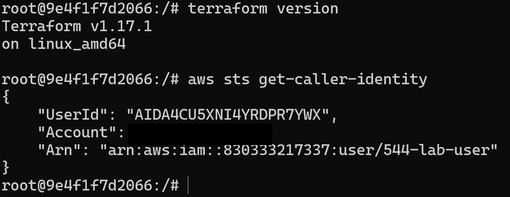

Part A: the plan before the first apply, the second apply showing No changes , the in-place update plan ( ~ ) and the replacement plan ( -/+ ), with a sentence on why -/+ is the one to be careful about.
First Terraform Plan
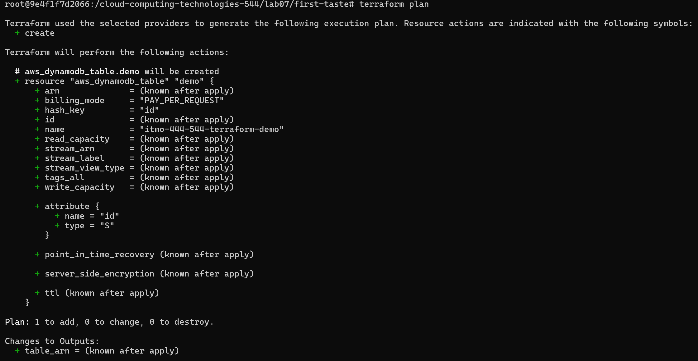
First Apply
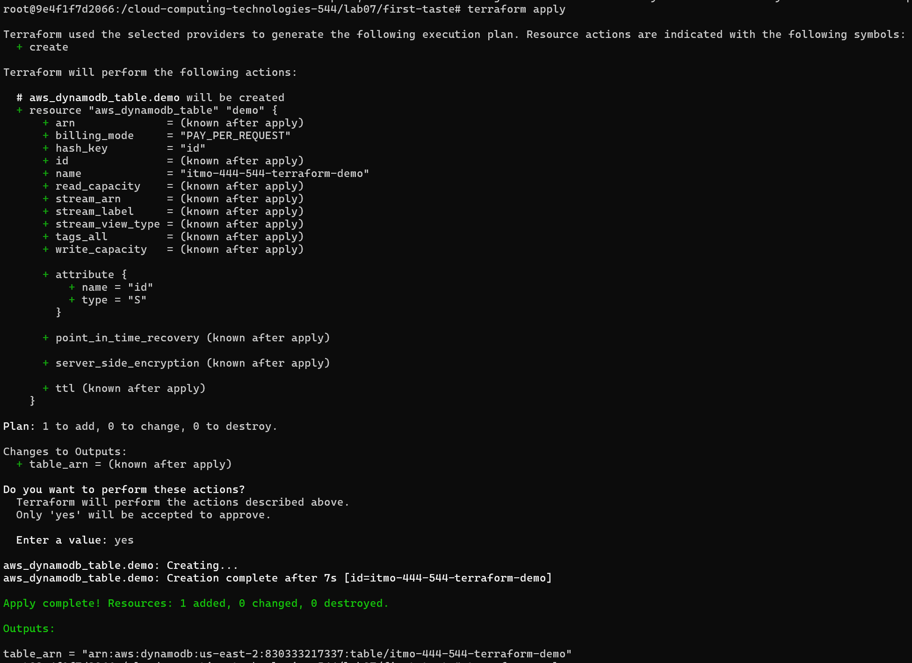
Second Apply
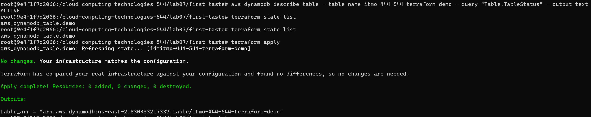
In Place Plan
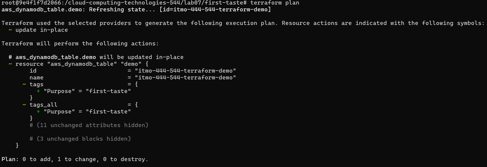
Replacement Plan
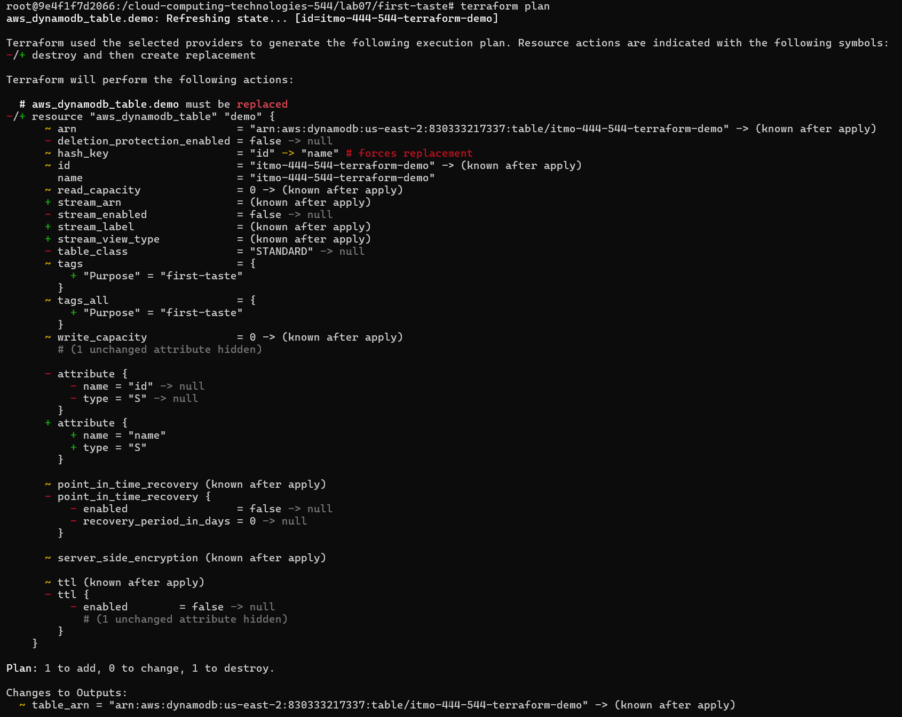

The -/+ is important to look at because these are the changes that are beind made. In this case since we are changing key components of the terraform plan all the previous file components are being removed (-) and are being 'recreated' showing (+) these signs help indicate what is actually changing. The ~ shows for a few things like the tags and the arn that will be the same regardless.clear

Output of terraform fmt , terraform validate and the last lines of terraform plan showing the number of resources to add.
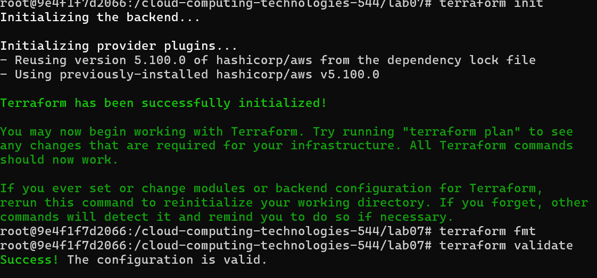
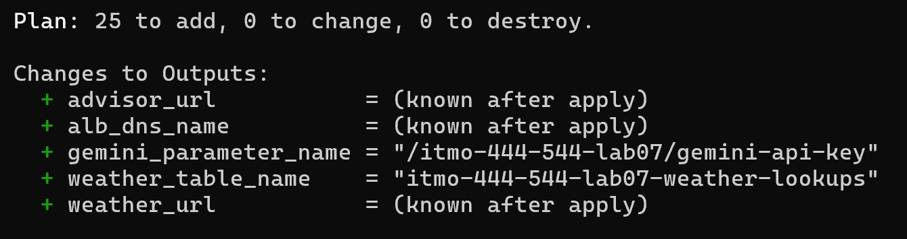

Output of app_smoke_test.py with all nine checks passing, and a screenshot of the advisor page.
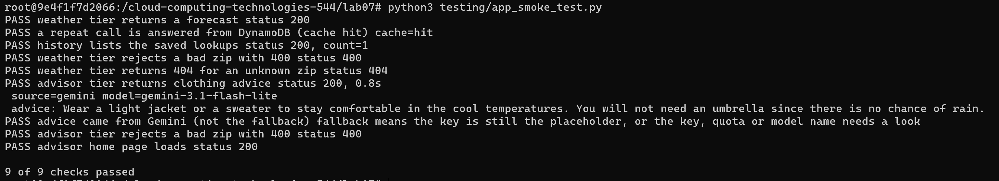

Steps 1 to 3: your effort table with line counts, the terraform graph output with your sentence, and the No changes plan with your sentence comparing it to running the bash script twice.
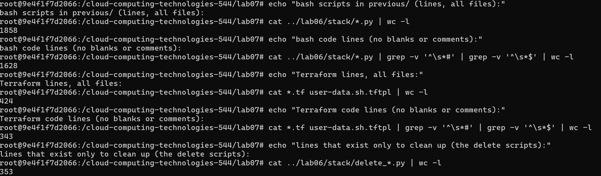
## Effort Table
| Topic | Lab06 Python | Lab07 Terraform |
| :--- | :--- | :--- |
| Lines to **create** the stack | 776 | 424
| Lines to **delete** the stack | 353 | 0
| Steps you had to order by hand | ? | 0
| Helper functions you wrote | 15 | 0
| Retry or wait loops you wrote | At least 10? | 0
## Graph
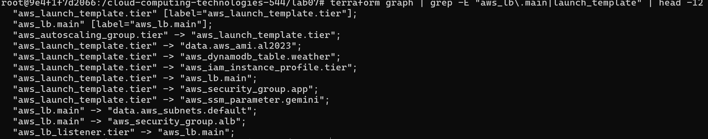
## No Changes Terraform Plan
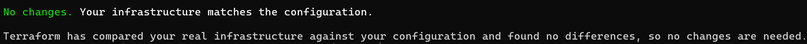

## Comparison
# Create comparison sentence
Terraform makes it alot simpler to see what changes are actually going to happen 

Steps 4 and 5: the plan for cache_seconds = 60 , the instance refresh status and new CACHE_SECONDS=60 line, and the drift plans with your sentence about ensure_target_group.
## Cache Seconds
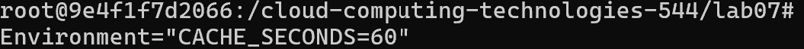

## Changes

## Drift

## Drift Sentence

Steps 6 and 7: the IAM simulator results with your sentence about the advisor tier, and the No changes plan, the grep -c count of 0 and your sentences about ignore_changes.
## IAM Simulator
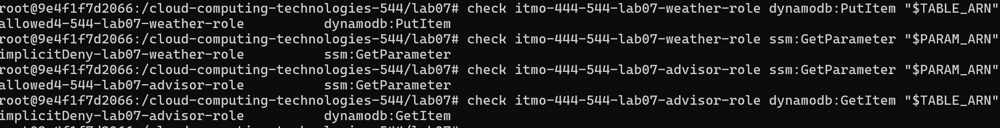
## No Changes
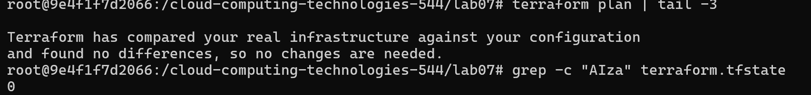
## write two sentences on what the next terraform apply would do to your key, and what would then be in the state.

Steps 8 and 9: the fallback answers with the gemini_error journal line and your sentence about silent fallback, and the completed Lambda table with your answer to question 4.
## Fallback
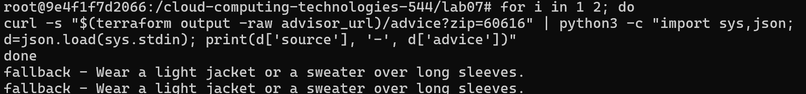
## Gemini Error
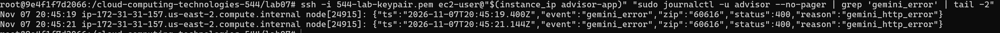
## Write down one problem with a design where users never see an error and the only evidence is a log line that nobody reads.
Silent fallbacks make the users fele that everything is working correctly even if it is not leading to false trust in the advice. 
## Lambda Table
| Advisor on EC2 (this lab) | Advisor on Lambda | Lab07 Effort Moved to |
| :--- | :--- | :--- |
| Launch template and user-date | Replaced by aws_lambda_function config (runtime, memory, environment variables). | Lambda (AWS manages underlying OS and hardware runtime execution). |
| Auto Scaling Group and instance refresh | Removed completely; Lambda scales automatically per request concurrency. | Lambda (AWS manages request-based scaling and provisioning automatically). |
| App security group rule for port 3000 | Removed; Lambda does not listen on host network ports. | Lambda (Network isolation managed within AWS Lambda service perimeter).|
| Instnace profile and role | Replaced by Lambda Execution Role (aws_iam_role) assumed by lambda.amazonaws.com.| Terraform (Defining Lambda trust relationship instead of EC2 instance profile). |
| Node.js install and systemd service | Replaced by standard AWS Lambda Node.js runtime and event handler function code. | Developer Code (Refactoring Express server code to process ALB JSON event triggers). | 
| Health check and grace period | Simplified; ALB checks Lambda function availability directly via Target Group health checks. | Terraform / AWS (Managed natively via ALB-to-Lambda invocation integration). | 

Step 10: the terraform destroy plan and total time, your cost estimate (hours multiplied by the hourly cost), and the verification commands showing nothing remains.
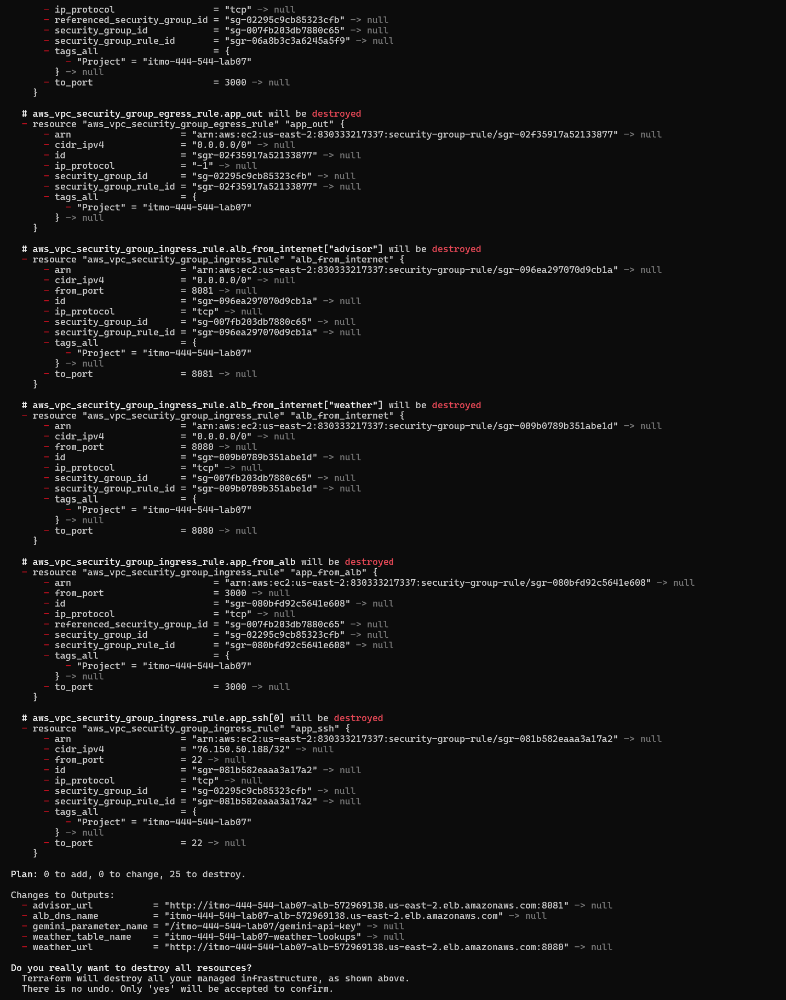
## Total Time
1.25 Hours of runtime
## Cost Estimate
1.25 hours * 0.7 cents ~ 0.88 cents
## Destruction
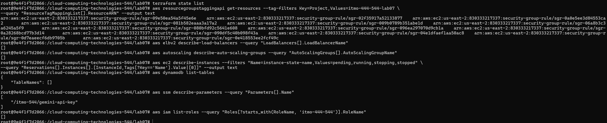

## Short answers: 
### How Terraform is like AWS Lambda and where the comparison stops, what Terraform did not make easier
Both terraform and AWS Lambda remove manual infrastructure management. But Terraform runs at deployment/build time while AWS Lambda runs at runtime and is more active for scaling
Terraform has explicit states with terraform.tfstate to track resources but Lambda is stateless and relies on extenral services like DynamoDB or S3 buckets.
Terraform made it even easier to deploy the infrastructure as compared to previous bash and python scripts but python is still needed for the testing script 

## Review Questions:
[Section 13.1 review questions](review_questions.md)
